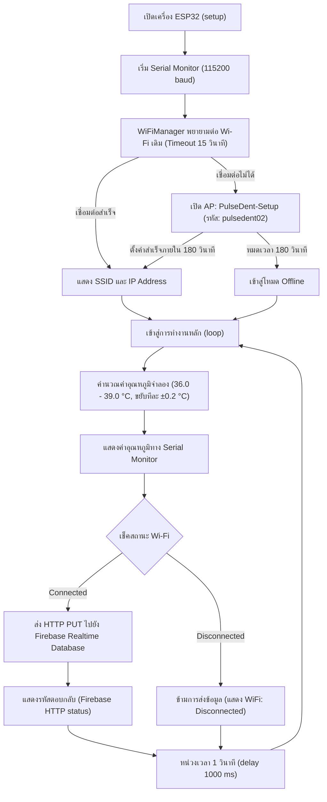

# สรุปการทำงานของระบบ ESP32 (Pulse Dent 02)

เอกสารนี้สรุปการทำงานปัจจุบันของเฟิร์มแวร์ ESP32 ในไฟล์ [`src/main.cpp`](src/main.cpp) และการตั้งค่าโปรเจกต์ใน [`platformio.ini`](platformio.ini)

---

## 1. ภาพรวมของระบบ (System Overview)

บอร์ด **ESP32 (esp32dev)** ทำหน้าที่จำลองค่าอุณหภูมิร่างกายในช่วง **36.00 – 39.00 °C** และส่งข้อมูลแบบเรียลไทม์ขึ้นไปยัง **Firebase Realtime Database** ทุก ๆ รอบการทำงาน (1 วินาที) โดยมีระบบ **WiFiManager** ช่วยจัดการการตั้งค่า Wi-Fi ผ่านหน้าเว็บ (Captive Portal) โดยไม่ต้องแก้รหัส Wi-Fi ในโค้ด

---

## 2. แผนผังลำดับการทำงาน (Workflow Diagram)



---

## 3. รายละเอียดการทำงานแต่ละส่วน

### 3.1 การตั้งค่าเริ่มต้นและการเชื่อมต่อ Wi-Fi (`setup()`)
1. เริ่มต้นพอร์ตสื่อสาร `Serial` ที่ความเร็ว **115200 baud**
2. เรียกใช้ไลบรารี `WiFiManager`:
   - **พยายามเชื่อมต่อ Wi-Fi เดิมอัตโนมัติ** เป็นเวลาสูงสุด **15 วินาที** (`wm.setConnectTimeout(15)`)
   - **หากเชื่อมต่อไม่ได้** บอร์ดจะปล่อยสัญญาณ Wi-Fi Access Point:
     - **ชื่อ Wi-Fi (SSID):** `PulseDent-Setup`
     - **รหัสผ่าน:** `pulsedent02`
     - **เวลาจำกัดในการตั้งค่า:** **180 วินาที (3 นาที)** (`wm.setConfigPortalTimeout(180)`)
   - หากเชื่อมต่อสำเร็จ จะแสดงชื่อ Wi-Fi (`SSID`) และ `IP Address` ออกทาง Serial Monitor
   - หากครบ 3 นาทีแล้วยังไม่ได้ตั้งค่า บอร์ดจะแสดง `Running offline...` และทำงานต่อใน `loop()` โดยไม่ค้าง

### 3.2 การจำลองค่าอุณหภูมิ (`loop()`)
- เริ่มต้นที่ `36.0 °C` และเปลี่ยนแปลงรอบละ `0.2 °C`
- **ขาขึ้น:** เพิ่มทีละ `+0.2 °C` จนถึง `39.0 °C`
- **ขาลง:** เมื่อแตะ `39.0 °C` จะสลับเป็นลดลงทีละ `-0.2 °C` จนกลับมาที่ `36.0 °C` แล้วสลับขึ้นใหม่วนไปเรื่อย ๆ

### 3.3 การส่งข้อมูลไปยัง Firebase (`sendTemperature()`)
เมื่อ Wi-Fi เชื่อมต่ออยู่ (`WL_CONNECTED`) บอร์ดจะส่งข้อมูลผ่าน HTTPS (`WiFiClientSecure` + `HTTPClient`):
- **Method:** `HTTP PUT` (เขียนทับข้อมูลล่าสุดที่ตำแหน่งเดิม ไม่สร้างรายการซ้ำ)
- **Database URL:** `https://pulsedent-02-default-rtdb.asia-southeast1.firebasedatabase.app`
- **Target Path:** `/devices/pulse-dent-01/latest.json`
- **รูปแบบ JSON ที่ส่ง:**
  ```json
  {
    "temperature": 36.20,
    "unit": "C",
    "status": "online",
    "timestamp": {".sv": "timestamp"}
  }
  ```
  *(หมายเหตุ: `{".sv": "timestamp"}` คือคำสั่งให้เซิร์ฟเวอร์ Firebase ประทับเวลาปัจจุบันแบบ Unix epoch milliseconds ให้อัตโนมัติ)*

---

## 4. ตัวอย่างผลลัพธ์ทาง Serial Monitor

เมื่อเชื่อมต่อ Wi-Fi และส่งข้อมูลเข้า Firebase สำเร็จ (`HTTP status: 200`):

```text
Pulse Dent 02
Starting WiFi Manager...
WiFi Connected!
SSID: Your_WiFi_Name
IP: 192.168.1.105
Temperature: 36.20 C
WiFi: Connected
Firebase HTTP status: 200
----------------
Temperature: 36.40 C
WiFi: Connected
Firebase HTTP status: 200
----------------
```

### ความหมายของรหัส `Firebase HTTP status`:
| รหัส (HTTP Code) | ความหมาย |
| :--- | :--- |
| **`200`** | ส่งและบันทึกข้อมูลลง Firebase สำเร็จ |
| **`400`** | รูปแบบ JSON หรือ URL ไม่ถูกต้อง |
| **`401` / `403`** | ติดสิทธิ์การเข้าถึง (ต้องตรวจสอบแท็บ **Rules** ใน Firebase Realtime Database) |
| **`-1` หรือค่าติดลบ** | เชื่อมต่ออินเทอร์เน็ตหรือเซิร์ฟเวอร์ Firebase ไม่ได้ |

---

## 5. โครงสร้างไฟล์และไลบรารีที่ใช้

- **[`platformio.ini`](platformio.ini)**
  - Board: `esp32dev` (Espressif 32, Arduino Framework)
  - Library: `tzapu/WiFiManager @ ^2.0.17`
  - Built-in Libraries: `WiFi.h`, `HTTPClient.h`, `WiFiClientSecure.h`
- **[`src/main.cpp`](src/main.cpp)** — โค้ดหลักของเฟิร์มแวร์ ESP32
- **[`data/firebase_initial.json`](data/firebase_initial.json)** — ไฟล์โครงสร้าง JSON เริ่มต้นสำหรับ Import เข้า Firebase
